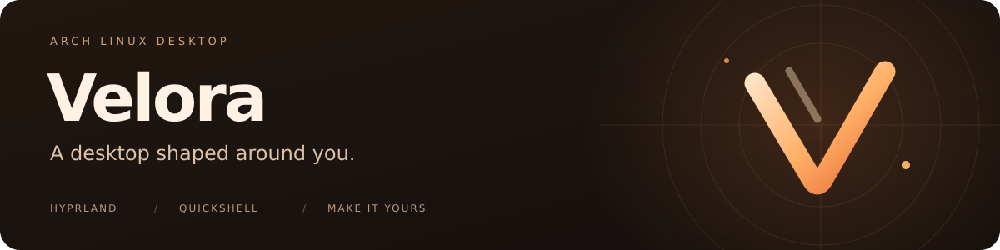

<h1 align="center">
  
</h1>

<p align="center"><strong>Your desktop. Every detail.</strong><br>Hyprland + Quickshell · Arch Linux</p>

<p align="center"><a href="#installation"><strong>Install Velora →</strong></a> · <a href="#pick-a-mood">Looks</a> · <a href="#documentation">Docs</a></p>

## Pick a mood

The default wallpaper is **Mountain · Night** by Andy Betts, licensed under
[CC BY-SA 4.0](licenses/CC-BY-SA-4.0.txt). Night, Pastel and Neon presets pair it
with different layouts and palettes. Aurora, Candy and Lime Grid provide live
shader backgrounds; Monochrome offers an attributed photograph.

[Wallpaper credits](dots/.config/quickshell/ii/assets/images/mountain-night.NOTICE.md).
The screenshot gallery is being refreshed with these wallpapers.

## Make it yours

Move and customize the bar, arrange desktop widgets, edit the lock screen, and
save your own presets. Choose local pictures, live shaders or your own videos.

## All your settings

Configure displays, input, sound, connections, apps, notifications and search
from one settings window. Open apps, workspaces and quick controls from the shell.

## Easy on your battery

Pause live wallpapers, reduce effects and slow background polling.
**Automatically on battery, or whenever you choose.**

## Installation

**Arch Linux is the only supported distribution.** Start with working graphics drivers, a normal user account, network access, and sudo configured. Velora uses Hyprland's Lua configuration format.

### 1. Install Git and Python

```bash
sudo pacman -Syu --needed git python
```

### 2. Download and install Velora

Run these commands as your normal user. The installer requests sudo when needed.

```bash
git clone --recurse-submodules https://github.com/FortyXD/Velora.git ~/Velora
cd ~/Velora
./velora install
```

The installer lets you choose optional components and review its plan. It installs dependencies, prepares a locked Python environment, and backs up configuration files before linking them. Existing shell settings are preserved; a failed linking attempt restores the files it changed.

### 3. Start your desktop

Log out and select **Hyprland** in your login screen. Without a login manager, start `start-hyprland` from a TTY. Follow the setup assistant, then open **Settings → Displays** to check resolution and scale. Review your keyboard layout and wallpaper path, too; the included configuration contains the maintainer's display defaults.

### Your first two minutes


1. **Make it comfortable.** Choose your language and check your display.
2. **Make it yours.** Pick a layout and wallpaper, then choose free or tiled windows. Extras are optional.
3. **Try the guided tour.** Practice opening apps, switching workspaces and using quick controls on your own desktop.


Reopen setup with **Super+Shift+Alt+/** or from **Settings → About**. **Super+I** opens Settings; **Super+Shift+Escape** closes the setup assistant.

### Optional components

Choose these in the installer, or review your choices later with `./velora components`.

| Component | What it adds |
| --- | --- |
| **Applications** | Dolphin, terminals and everyday desktop utilities. |
| **Live wallpapers** | Video wallpaper playback through mpvpaper. |
| **Toolbox** | Media conversion, downloads and document tools. |

Hyprland, Quickshell, required shell services, fonts and the Python environment are handled by the installer. You do not need to install the full dependency list by hand. [All components and requirements →](docs/installation.md)

### Build from source

Build Velora as an Arch package and build its core dependencies from source automatically:

```bash
./velora install --build-package --build-from-source
```

Use `--build-package` alone to package Velora, or `--build-from-source` alone to build the core dependencies. To select dependencies explicitly, use `--build-from-source quickshell,hyprland`. Your source-build choices are reused during updates.

<details>
<summary><strong>More installation options</strong> — preview, components, package archives, and flags</summary>

Preview the plan without changing files, or skip package installation on an already prepared system:

```bash
./velora install --dry-run
./velora install --skip-packages
```

Choose components interactively or exclude them explicitly:

```bash
./velora components
./velora install --without toolbox,live-wallpapers
```

Build a package archive without installing it:

```bash
./velora package --output ./artifacts/release
```

Official dependencies come from pacman. AUR packages use **yay** or **paru**; if neither is installed, the installer builds yay from its AUR recipe. Source builds fetch recipes from Arch's packaging repositories or AUR and use makepkg. Package managers retain their normal prompts. Dependencies are managed directly, without the old `illogical-impulse-*` metapackages.

| Flag | Behavior |
| --- | --- |
| `--skip-aur` | Omit AUR packages. |
| `--no-reload` | Keep the current Hyprland session running without a reload. |
| `--no-updates` | Disable scheduled update checks. |
| `--login-manager gdm` | Opt into GNOME's graphical login screen; `existing`, `sddm` and `skip` are also available. |
| `--yes` | Accept the installer plan; pacman and AUR helpers still prompt normally. |

Checkout installations link configuration into the repository, so keep the checkout in place. Package installations include Velora's actual source and maintenance tools and keep writable configuration under `~/.local/share/velora/runtime/`, preserving local edits when refreshing templates.

</details>

[Read the installation and recovery guide →](docs/installation.md)

## First steps

| Shortcut | Action |
| --- | --- |
| `Super` | Application search |
| `Super+I` | Settings |
| `Super+/` | Shortcut reference |
| `Super+Alt+J` | Bar editor |
| `Super+Shift+I` | Toolbox |
| `Super+N` | Quick settings and notifications |
| `Super+L` | Lock the screen |

Open **Settings → Presets** to save your current look. Visit **Settings → Wallpaper** for local images, online sources, live wallpapers, and animated backgrounds. Unsplash, Pexels, and Pixabay require your own API keys.

## Updates

**Check automatically. Install when you choose.**

1. Open **Settings → General → Software Update**.
2. Choose published GitHub releases or your tracked branch, and toggle automatic checks.
3. When a version is available, select **Install update** and confirm in the terminal.

The page shows installed and available versions. Background checks run approximately every six hours; opening the page also checks when automatic checks are enabled. **Update Velora** in the application launcher opens the same installation flow. Package installations build and install a new Velora package from the selected GitHub source.

```bash
velora update --check
velora update --interactive
velora update-settings --channel release
```

Updates reconcile dependencies and source builds, refresh the locked Python environment, and apply your saved installation choices. Checkout installations require clean, non-diverged Git history. Package installations retain edited runtime templates and save conflicting incoming templates for review.

<details>
<summary><strong>Maintenance and recovery commands</strong></summary>

```bash
velora doctor        # Diagnose tools, packages, and the Python environment
velora status        # Inspect installation and update state
velora restore       # List configuration backups
velora restore ID    # Restore a chosen backup
```

If `velora` is not on your PATH yet, use `./velora` from the checkout or `~/.local/bin/velora`.

</details>

[Read about updates and recovery →](docs/updates.md)

## Documentation

| Guide | Find what you need |
| --- | --- |
| [Installation](docs/installation.md) | Prerequisites, optional components, source builds, troubleshooting, and recovery. |
| [Updates](docs/updates.md) | GitHub channels, dependency management, automatic checks, and local edits. |
| [Development](docs/development.md) | Repository structure and working on Velora. |
| [Release process](docs/release.md) | Validation, packaging, and release preparation. |
| [Gallery and recording](docs/screenshots.md) | Still images, GIF capture, demo profiles and artwork credits. |
| [Third-party licensing](licenses/README.md) | Component licenses and attribution. |

<details>
<summary><strong>Project layout</strong></summary>

```text
velora                 Installation and maintenance command
scripts/               Installer, linking, builds, and updates
dependencies/          Arch dependency components and Python lockfile
packaging/             Arch package recipe template
dots/.config/          Desktop shell and application configuration
dots/.local/share/     Desktop integration, assets, and helper scripts
home/                  Shell entry files
dots-extra/            Optional application configurations and font sets
docs/                  Installation, updates, and development guides
tests/                 Installer and updater regression tests
licenses/              Third-party notices and license texts
```

Internal paths such as `quickshell/ii`, `illogical-impulse`, and `folis` remain in use for compatibility with existing configurations and integrations.

</details>

Report bugs or request features in [Velora issues](https://github.com/FortyXD/Velora/issues). For installation or update problems, include the command, relevant output, and `velora doctor` results.

## Credits and license

Velora is an independently maintained fork of [Illogical Impulse](https://github.com/end-4/dots-hyprland), with its own development direction. It builds on the work of **end-4 and the Illogical Impulse contributors**, **outfoxxed and Quickshell contributors**, and **Hyprland contributors**. Additional acknowledgements are retained in [NOTICE](NOTICE), with component-specific attribution in [licenses/README.md](licenses/README.md).

Velora is distributed under the **GNU General Public License, version 3**. See [LICENSE](LICENSE). Third-party code and assets retain their respective licenses and attribution.
