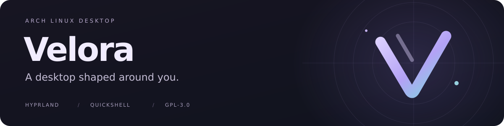
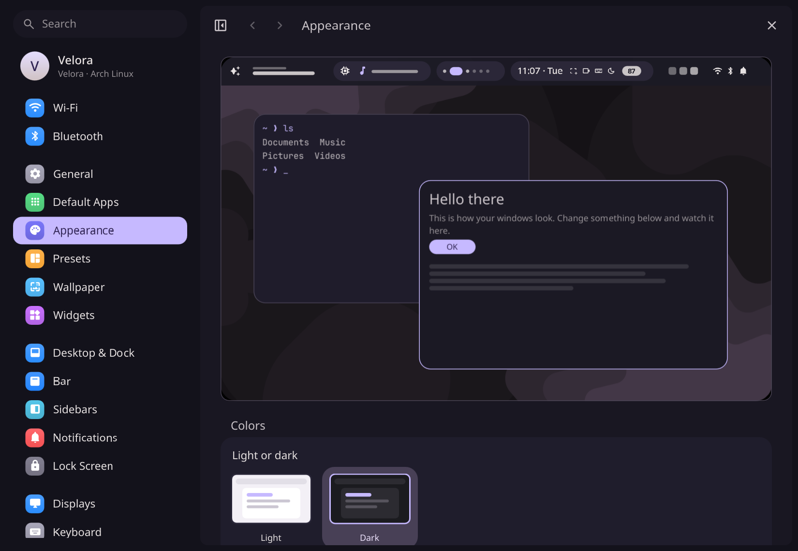
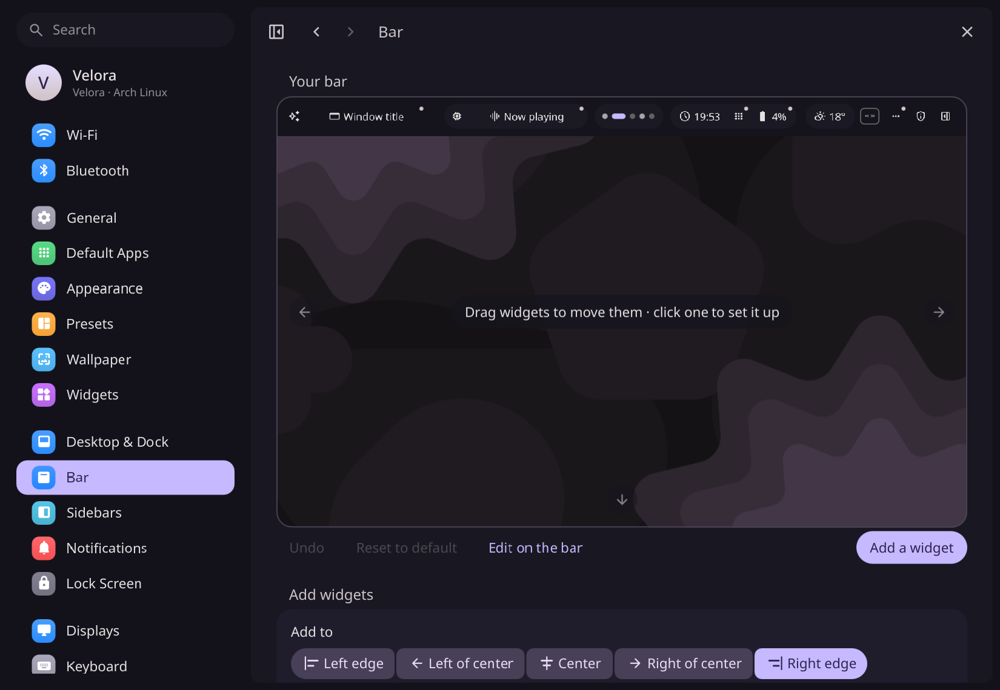
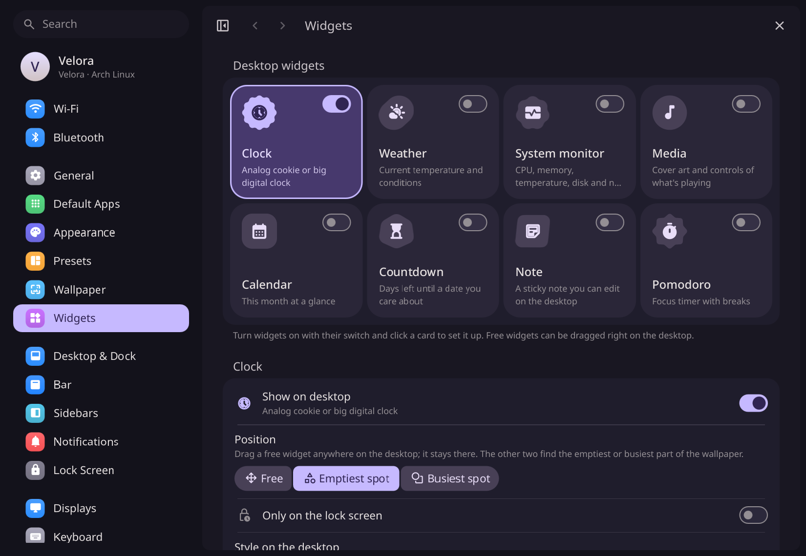
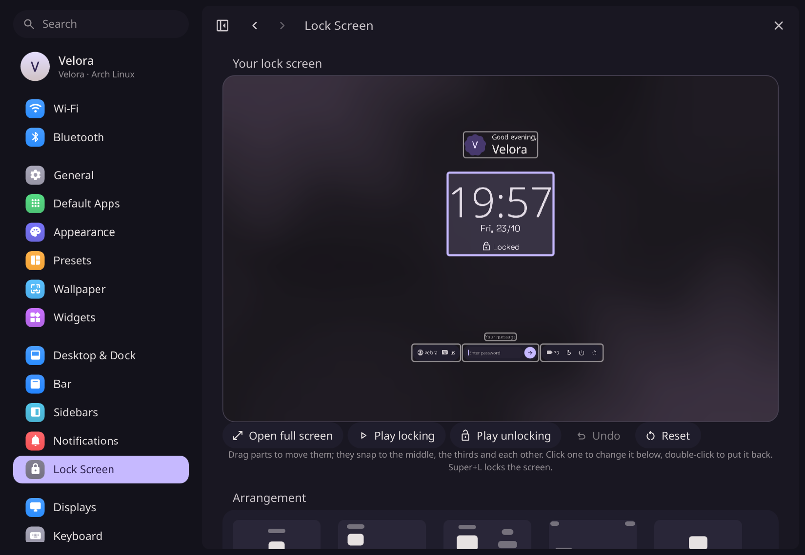
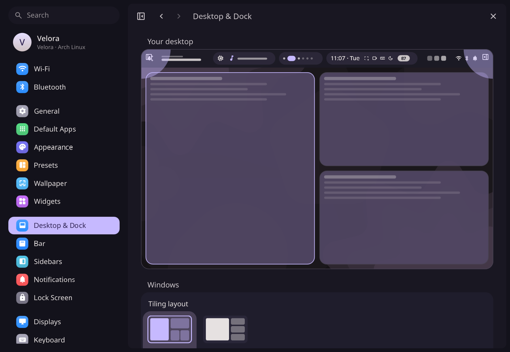

<h1 align="center">
  
</h1>

<p align="center">
  A customizable desktop for <strong>Arch Linux</strong>, powered by <strong>Hyprland</strong> and <strong>Quickshell</strong>.
</p>

<p align="center">
  <a href="#installation"><strong>Install Velora</strong></a> ·
  <a href="#screenshots">Screenshots</a> ·
  <a href="#features">Features</a> ·
  <a href="#updates">Updates</a> ·
  <a href="#documentation">Documentation</a>
</p>

Arrange your bar, build a desktop layout, save complete looks, and manage everyday controls through one settings app. Velora brings visual editors, desktop tools, and a guided installation and update workflow into a desktop you can make your own.

Velora is an independently maintained fork of [Illogical Impulse by end-4](https://github.com/end-4/dots-hyprland), with its own development direction. Upstream credits and licenses are preserved.

## Screenshots

[](.github/assets/screenshots/appearance.png)

<p align="center"><em>Appearance settings — preview your colors, windows, and bar together.</em></p>

<table>
  <tr>
    <td width="50%">
      <a href=".github/assets/screenshots/bar.png"></a>
      <br><strong>Build your bar</strong><br>Arrange widgets, groups, and actions visually.
    </td>
    <td width="50%">
      <a href=".github/assets/screenshots/widgets.png"></a>
      <br><strong>Choose your widgets</strong><br>Put useful information on your desktop.
    </td>
  </tr>
  <tr>
    <td width="50%">
      <a href=".github/assets/screenshots/lock.png"></a>
      <br><strong>Design your lock screen</strong><br>Position the clock, greeting, and other elements.
    </td>
    <td width="50%">
      <a href=".github/assets/screenshots/desktop.png"></a>
      <br><strong>Shape your workspace</strong><br>Choose your window layout and spacing.
    </td>
  </tr>
</table>

Screenshots show the actual settings app with an English demo profile and a custom accent palette. Embedded desktop and lock screen miniatures are the app's live previews. Click any image to open it at full size. [Screenshot notes](docs/screenshots.md).

## Features

| Make it yours | What you can do |
| --- | --- |
| **Bar and desktop** | Drag bar widgets into five placement zones, group them into pills, assign actions, and arrange clocks, weather, media, and productivity widgets. |
| **Appearance and presets** | Change colors, transparency, spacing, outlines, dock, and animations. Save complete looks, select which parts to apply, and undo a preset change. |
| **Lock screen and wallpapers** | Edit the lock screen with a live preview. Use local images, online collections, daily wallpapers, videos through mpvpaper, or animated shader backgrounds. |
| **Sidebars** | Reorder, hide, and configure every part of the right sidebar by dragging it in a live picture; arrange quick toggles, widget tabs, and the left sidebar's tabs. |
| **Everyday controls** | Manage devices and per-app audio, test your microphone, set per-app notification rules, customize quick settings, and configure keyboard shortcuts and hot corners. Weather finds your place by GPS, a city, or your IP address and keeps a forecast. |
| **Focus and battery** | Use countdown, stopwatch, and Pomodoro timers. Reduce animations, blur, wallpaper playback, and polling manually or automatically on battery. |
| **Built-in tools** | Convert media and documents, download videos with yt-dlp, work with QR codes, extract text with OCR, and pick colors. Use Dolphin context menus for file actions. Office conversion uses LibreOffice when installed. |

Application search, workspace previews, clipboard history, and media controls stay close at hand. The Illogical Impulse foundation's assistant and translation features are also available.

## Installation

**Arch Linux is the only supported distribution.** Start with working graphics drivers, a normal user account, network access, and sudo configured. Velora uses Hyprland's Lua configuration format.

```bash
sudo pacman -Syu --needed git python

git clone --recurse-submodules https://github.com/FortyXD/Velora.git ~/Velora
cd ~/Velora
./velora install
```

The installer lets you choose optional components and review its plan. It installs dependencies, prepares a locked Python environment, and backs up configuration files before linking them. Existing shell settings are preserved; a failed linking attempt restores the files it changed.

**After installation:** open **Settings → Displays** and check monitor resolution and scale. Also review your keyboard layout and wallpaper path. The included configuration contains the maintainer's display defaults.

### Build from source

Build Velora as an Arch package and build its core dependencies from source automatically:

```bash
./velora install --build-package --build-from-source
```

Use `--build-package` alone to package Velora, or `--build-from-source` alone to build the core dependencies. To select dependencies explicitly, use `--build-from-source quickshell,hyprland`. Your source-build choices are reused during updates.

<details>
<summary><strong>More installation options</strong> — preview, components, package archives, and flags</summary>

Preview the plan without changing files, or skip package installation on an already prepared system:

```bash
./velora install --dry-run
./velora install --skip-packages
```

Choose components interactively or exclude them explicitly:

```bash
./velora components
./velora install --without toolbox,live-wallpapers
```

Build a package archive without installing it:

```bash
./velora package --output ./artifacts/release
```

Official dependencies come from pacman. AUR packages use **yay** or **paru**; if neither is installed, the installer builds yay from its AUR recipe. Source builds fetch recipes from Arch's packaging repositories or AUR and use makepkg. Package managers retain their normal prompts. Dependencies are managed directly, without the old `illogical-impulse-*` metapackages.

| Flag | Behavior |
| --- | --- |
| `--skip-aur` | Omit AUR packages. |
| `--no-reload` | Keep the current Hyprland session running without a reload. |
| `--no-updates` | Disable scheduled update checks. |
| `--yes` | Accept the installer plan; pacman and AUR helpers still prompt normally. |

Checkout installations link configuration into the repository, so keep the checkout in place. Package installations include Velora's actual source and maintenance tools and keep writable configuration under `~/.local/share/velora/runtime/`, preserving local edits when refreshing templates.

</details>

[Read the installation and recovery guide →](docs/installation.md)

## First steps

| Shortcut | Action |
| --- | --- |
| `Super` | Application search |
| `Super+I` | Settings |
| `Super+/` | Shortcut reference |
| `Super+Alt+J` | Bar editor |
| `Super+Shift+I` | Toolbox |
| `Super+N` | Quick settings and notifications |
| `Super+L` | Lock the screen |

Open **Settings → Presets** to save your current look. Visit **Settings → Wallpaper** for local images, online sources, live wallpapers, and animated backgrounds. Unsplash, Pexels, and Pixabay require your own API keys.

## Updates

**Check automatically. Install when you choose.**

1. Open **Settings → About → GitHub updates**.
2. Choose published GitHub releases or your tracked branch, and toggle automatic checks.
3. When a version is available, select **Install update** and confirm in the terminal.

The page shows installed and available versions. Background checks run approximately every six hours; opening the page also checks when automatic checks are enabled. **Update Velora** in the application launcher opens the same installation flow. Package installations build and install a new Velora package from the selected GitHub source.

```bash
velora update --check
velora update --interactive
velora update-settings --channel release
```

Updates reconcile dependencies and source builds, refresh the locked Python environment, and apply your saved installation choices. Checkout installations require clean, non-diverged Git history. Package installations retain edited runtime templates and save conflicting incoming templates for review.

<details>
<summary><strong>Maintenance and recovery commands</strong></summary>

```bash
velora doctor        # Diagnose tools, packages, and the Python environment
velora status        # Inspect installation and update state
velora restore       # List configuration backups
velora restore ID    # Restore a chosen backup
```

If `velora` is not on your PATH yet, use `./velora` from the checkout or `~/.local/bin/velora`.

</details>

[Read about updates and recovery →](docs/updates.md)

## Documentation

| Guide | Find what you need |
| --- | --- |
| [Installation](docs/installation.md) | Prerequisites, optional components, source builds, troubleshooting, and recovery. |
| [Updates](docs/updates.md) | GitHub channels, dependency management, automatic checks, and local edits. |
| [Development](docs/development.md) | Repository structure and working on Velora. |
| [Release process](docs/release.md) | Validation, packaging, and release preparation. |
| [Screenshot notes](docs/screenshots.md) | Gallery contents and capturing updated screenshots. |
| [Third-party licensing](licenses/README.md) | Component licenses and attribution. |

<details>
<summary><strong>Project layout</strong></summary>

```text
velora                 Installation and maintenance command
scripts/               Installer, linking, builds, and updates
dependencies/          Arch dependency components and Python lockfile
packaging/             Arch package recipe template
dots/.config/          Desktop shell and application configuration
dots/.local/share/     Desktop integration, assets, and helper scripts
home/                  Shell entry files
dots-extra/            Optional application configurations and font sets
docs/                  Installation, updates, and development guides
tests/                 Installer and updater regression tests
licenses/              Third-party notices and license texts
```

Internal paths such as `quickshell/ii`, `illogical-impulse`, and `folis` remain in use for compatibility with existing configurations and integrations.

</details>

Report bugs or request features in [Velora issues](https://github.com/FortyXD/Velora/issues). For installation or update problems, include the command, relevant output, and `velora doctor` results.

## Credits and license

Velora builds on the work of **end-4 and the Illogical Impulse contributors**, **outfoxxed and Quickshell contributors**, and **Hyprland contributors**. Additional acknowledgements are retained in [NOTICE](NOTICE), with component-specific attribution in [licenses/README.md](licenses/README.md).

Velora is distributed under the **GNU General Public License, version 3**. See [LICENSE](LICENSE). Third-party code and assets retain their respective licenses and attribution.
